

<picture><source media="(prefers-color-scheme: dark)" srcset="assets/about-dark.svg"></picture>

<picture><source media="(prefers-color-scheme: dark)" srcset="assets/hero-dark.svg"></picture>

<picture><source media="(prefers-color-scheme: dark)" srcset="assets/social-l-dark.svg"></picture><a href="https://t.me/SPiDER_VPN1"><picture><source media="(prefers-color-scheme: dark)" srcset="assets/social-1-dark.svg"></picture></a><a href="https://discord.com/"><picture><source media="(prefers-color-scheme: dark)" srcset="assets/social-2-dark.svg"></picture></a><a href="https://x.com/"><picture><source media="(prefers-color-scheme: dark)" srcset="assets/social-3-dark.svg"></picture></a><picture><source media="(prefers-color-scheme: dark)" srcset="assets/social-r-dark.svg"></picture>

<picture><source media="(prefers-color-scheme: dark)" srcset="assets/stack-dark.svg"></picture>

<a href="https://github.com/amirh00sain/SpiderPanel"><picture><source media="(prefers-color-scheme: dark)" srcset="assets/project-spiderpanel-dark.svg"></picture></a>&nbsp;<a href="https://github.com/amirh00sain/vpn_ui_railway"><picture><source media="(prefers-color-scheme: dark)" srcset="assets/project-vpn-ui-railway-dark.svg"></picture></a>

<a href="https://github.com/amirh00sain/spiderpanel_zerops"><picture><source media="(prefers-color-scheme: dark)" srcset="assets/project-spiderpanel-zerops-dark.svg"></picture></a>&nbsp;<a href="https://github.com/amirh00sain/rebecca"><picture><source media="(prefers-color-scheme: dark)" srcset="assets/project-rebecca-dark.svg"></picture></a>

<picture><source media="(prefers-color-scheme: dark)" srcset="assets/stats-dark.svg"></picture>

<picture><source media="(prefers-color-scheme: dark)" srcset="assets/wave-dark.svg"></picture>

<picture><source media="(prefers-color-scheme: dark)" srcset="assets/streak-dark.svg"></picture>

<a href="https://spiderpanel.xfdscscsa.de5.net/"><picture><source media="(prefers-color-scheme: dark)" srcset="assets/button-1-dark.svg"></picture></a>&nbsp;&nbsp;<a href="https://github.com/amirh00sain?tab=repositories"><picture><source media="(prefers-color-scheme: dark)" srcset="assets/button-2-dark.svg"></picture></a>

<a href="https://metawka.github.io/expressive-profile/?from=amirh00sain"><picture><source media="(prefers-color-scheme: dark)" srcset="assets/credit-dark.svg"></picture></a>

